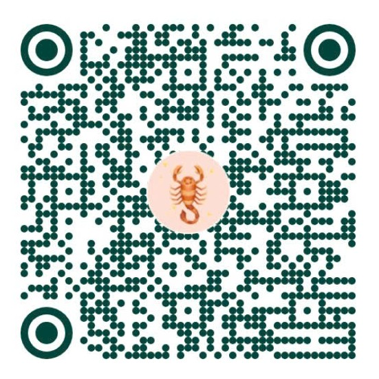

# Mời Cà Phê ☕ & Hỗ Trợ Dự Án

Nếu ứng dụng **NSN Word Mail Merge Web Pro** giúp bạn tiết kiệm thời gian trộn văn bản, xuất hồ sơ hành chính hoặc giải quyết hiệu quả công việc hàng ngày, hãy ủng hộ tác giả một tách cà phê nhé!

Mỗi sự khích lệ và đồng hành của bạn là nguồn động lực to lớn để tác giả tiếp tục duy trì, nâng cấp và phát triển thêm nhiều tiện ích hữu ích cho cộng đồng.

---

## 💳 Thông tin Chuyển khoản (VietQR)

| Hạng mục | Chi tiết |
|:---|:---|
| **Chủ tài khoản** | **NGUYEN SON NAM** |
| **Số tài khoản** | **`8855989777`** |
| **Ngân hàng** | **BIDV — Ngân hàng TMCP Đầu tư và Phát triển Việt Nam** |
| **Chi nhánh / PGD** | PGD Nguyễn Tất Thành |
| **Nội dung gợi ý** | `Ung ho NSN Mail Merge Web` |

---

## 📱 Quét mã VietQR Chuyển nhanh

Bạn có thể mở ứng dụng Ngân hàng (hoặc ví điện tử) trên điện thoại và quét mã VietQR bên dưới:

---

## 👨‍💻 Thông tin Tác giả

- **Họ và tên:** Nguyễn Sơn Nam
- **Biệt danh / Ký hiệu:** Nsnnam · NamNS · NSN
- **GitHub:** [https://github.com/Nsnnam](https://github.com/Nsnnam)
- **Email:** akahimachi@gmail.com

*Chân thành cảm ơn sự đồng hành và ủng hộ quý báu của bạn!*
